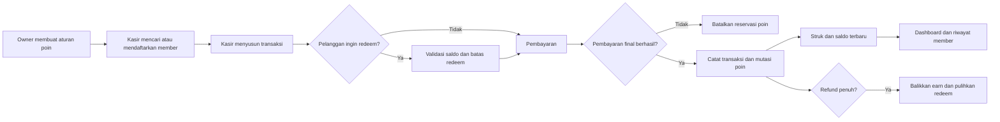
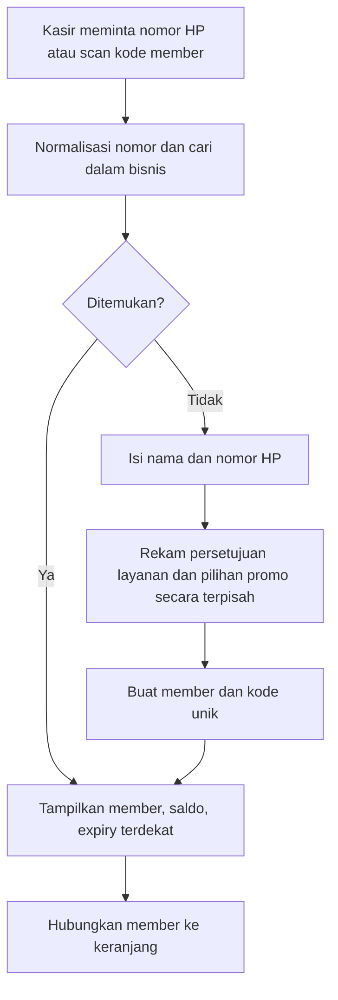
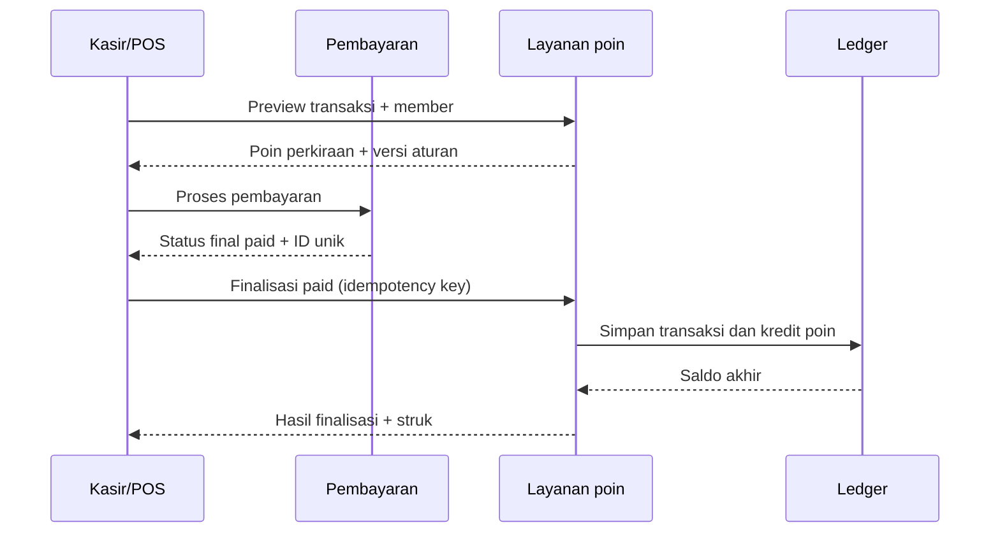
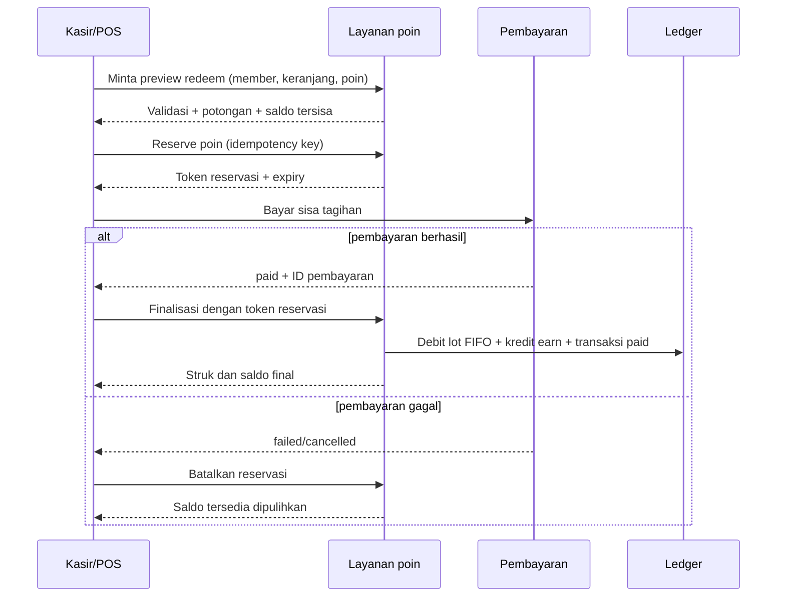

# Alur operasional — sistem poin toko dan membership

Pendamping [PRD](./PRD-sistem-poin-membership.md). Alur ini adalah rancangan MVP satu bisnis dengan saldo bersama antar outlet milik bisnis tersebut. Istilah **member** berarti pelanggan yang tercatat; **poin tersedia** berarti poin yang belum dipakai, belum kedaluwarsa, dan sudah dikurangi utang poin akibat pembalikan.

## 1. Peta perjalanan pengguna

## 2. Aktivasi program oleh owner

| Langkah | Aktor | Aksi sistem | Hasil |
|---|---|---|---|
| 1 | Owner | Buka Pengaturan → Program Poin | Tampilkan aturan aktif dan riwayat versi |
| 2 | Owner | Isi minimum belanja, rasio earn, nilai redeem, limit, expiry, produk eligible | Validasi angka positif, tanggal efektif, dan tidak ada konflik aturan |
| 3 | Owner | Jalankan simulasi dengan contoh transaksi | Preview earn/redeem dan nilai rupiah; tampilkan rumus |
| 4 | Owner | Simpan dan aktifkan | Terbit `point_rule_version` baru; versi lama tetap untuk histori |
| 5 | Sistem | Memberi aturan ke semua outlet bisnis | Checkout berikutnya memakai versi yang aktif saat pembayaran final |

**Keadaan:** `draft → scheduled/active → archived`. Aturan aktif tidak diedit langsung; perubahan membuat versi baru. Jika belum ada aturan aktif, kasir dapat bertransaksi tetapi tidak menampilkan earn/redeem.

## 3. Pendaftaran dan identifikasi member

**Validasi:** nomor yang sama dalam bisnis tidak boleh menjadi dua member aktif. Nomor serupa dengan format berbeda harus dinormalisasi. Jika nomor salah atau pelanggan tidak ingin menjadi member, checkout tetap dapat berjalan tanpa poin. Identitas pada penukaran bernilai besar memerlukan langkah verifikasi tambahan sesuai pengaturan owner.

**Kriteria penerimaan:**

- Cari nomor `0812...` dan `+62812...` mengarah ke member yang sama jika keduanya ekuivalen.
- Kasir outlet A tidak dapat melihat member bisnis B.
- Opt-in promo kosong berarti tidak boleh mengirim promosi; notifikasi transaksi mengikuti izin layanan yang relevan.

## 4. Perolehan poin tanpa redeem

1. Kasir memilih produk dan member, lalu sistem menampilkan **perkiraan** poin berdasarkan aturan aktif.
2. Kasir memilih metode pembayaran. Sebelum pembayaran final, perkiraan dapat berubah jika keranjang/diskon berubah.
3. Setelah pembayaran dikonfirmasi, server mencatat transaksi `paid`, item, nominal eligible, ID pembayaran, versi aturan, dan kredit poin dalam satu proses finalisasi yang aman terhadap retry.
4. Sistem membuat lot poin dengan tanggal kedaluwarsa dan menampilkan saldo akhir pada struk/riwayat.
5. Notifikasi, jika diaktifkan, dikirim asinkron; kegagalan notifikasi tidak mengubah status transaksi.

**Pengecualian:** jika pembayaran gagal, tidak ada kredit. Jika panggilan finalisasi timeout, POS mengulang dengan ID yang sama dan menerima hasil transaksi yang sama. Jika layanan poin tidak tersedia setelah pembayaran sukses, transaksi ditandai `loyalty_pending`, lalu diproses ulang terkontrol; struk tidak boleh mengklaim poin sudah masuk.

## 5. Penukaran poin saat checkout

1. Kasir memilih member. Sistem mengambil saldo **terbaru**, nilai tukar, minimum, batas per transaksi, dan poin yang akan kedaluwarsa.
2. Kasir memasukkan jumlah poin yang ingin dipakai. Sistem menampilkan potongan rupiah serta sisa tagihan.
3. Pelanggan menyetujui penukaran. Bila melebihi ambang, lakukan OTP atau persetujuan manajer.
4. Sistem mereservasi poin dengan masa hidup singkat untuk mencegah dua checkout memakai saldo yang sama.
5. Pembayaran sisa tagihan diproses. Saat finalisasi sukses, reservasi dikonsumsi menjadi debit ledger; poin baru dihitung dari basis setelah potongan poin; kredit baru dicatat bila memenuhi syarat.
6. Jika pembayaran gagal, dibatalkan, atau reservasi habis, poin kembali tersedia dan kasir harus memulai validasi ulang.

**Validasi penukaran:** poin harus integer positif; minimal 10 poin pada konfigurasi contoh; tidak lebih dari saldo tersedia, 50% nilai eligible, atau sisa tagihan. Potongan dihitung dari nilai rupiah per poin pada versi aturan yang berlaku. Penukaran dari lot dengan expiry paling dekat dilakukan lebih dahulu. Perubahan saldo/expiry di antara preview dan finalisasi harus menyebabkan hitung ulang atau penolakan yang jelas.

**Kriteria penerimaan:** dua kasir yang mencoba memakai 100 poin ketika saldo 100 tidak dapat sama-sama berhasil. Retry dengan token/ID sama tidak membuat debit tambahan. Struk memuat poin dipakai, rupiah potongan, poin baru, dan saldo akhir.

## 6. Refund penuh

| Langkah | Aktor/sistem | Ketentuan |
|---|---|---|
| 1 | Manajer/owner mencari transaksi `paid` | Tampilkan nominal, poin diperoleh, poin dipakai, dan apakah pernah direfund |
| 2 | Operator mengisi alasan dan mengonfirmasi | Hak akses diperiksa; refund kedua ditolak/idempoten |
| 3 | POS membalik pembayaran sesuai metode yang digunakan | Bila pembalikan pembayaran gagal, mutasi poin belum difinalkan |
| 4 | Sistem mencatat transaksi `refunded` dan reversal poin | Kredit hasil pembelian dibalik; lot poin yang dipakai dipulihkan dengan expiry asal |
| 5 | Sistem memperbarui saldo dan laporan | Audit menyimpan operator, alasan, waktu, ID refund |

Jika poin yang dulu diperoleh sudah dibelanjakan, refund tetap boleh dilakukan. Pembalikan menciptakan **utang poin** pada ledger. Saldo tersedia tampil 0 sampai poin dari transaksi berikutnya menutup utang. Jika poin yang dipakai pada transaksi refund sudah melewati expiry aslinya, poin tersebut tidak kembali menjadi saldo yang dapat dibelanjakan. Kebijakan ini harus ditampilkan kepada operator sebelum konfirmasi refund.

## 7. Kedaluwarsa poin

1. Job harian mengambil lot dengan `expires_at` terlewati dan sisa poin positif.
2. Sistem membuat event `expire` sekali per lot/sisa yang berlaku, lalu memperbarui saldo proyeksi.
3. Owner melihat jumlah poin kedaluwarsa pada laporan; pelanggan melihatnya pada riwayat.
4. Job aman dijalankan ulang. Checkout selalu menghitung ketersediaan berdasar waktu server sehingga poin kedaluwarsa tidak bisa dipakai meskipun job terlambat.

## 8. Laporan dan rekonsiliasi

Dashboard owner memiliki filter periode dan outlet. Metrik minimum: transaksi lunas, transaksi member, member baru/aktif, poin diterbitkan, poin ditukar, poin kedaluwarsa, poin hasil refund/koreksi, saldo poin beredar, dan estimasi kewajiban rupiah. Setiap angka dapat ditelusuri ke daftar transaksi/ledger; ekspor memakai filter dan definisi yang sama. Poin yang diterbitkan di outlet A tetapi ditukar di outlet B tetap menjadi kewajiban bisnis yang sama, dengan dimensi outlet penerbit dan outlet penukar terpisah.

Rekonsiliasi harian membandingkan saldo proyeksi member dengan hitungan ulang ledger. Selisih masuk antrean investigasi dan tidak dikoreksi diam-diam.

## 9. Daftar layar MVP

| Layar | Pengguna | Isi dan aksi utama |
|---|---|---|
| Pengaturan program | Owner | Aturan aktif, versi, simulasi, jadwal aktif |
| Daftar member | Kasir/manajer | Cari nomor/kode, daftar, status member |
| Detail member | Kasir/manajer/owner | Saldo, expiry terdekat, riwayat terbatas menurut izin |
| Checkout | Kasir | Member terpilih, preview poin, redeem, sisa bayar, status final |
| Detail transaksi/struk | Kasir/manajer/member | Nominal, poin masuk/keluar, saldo sesudahnya |
| Refund | Manajer/owner | Alasan, dampak poin, konfirmasi, hasil |
| Dashboard loyalty | Owner | KPI, filter outlet/periode, drill-down ledger |
| Audit log | Owner | Mutasi aturan, koreksi, refund, login dan aktor |

## 10. Skenario uji penerimaan end-to-end

| ID | Skenario | Hasil yang diharapkan |
|---|---|---|
| A-01 | Daftar member baru, belanja Rp100.000 tanpa diskon | Dengan aturan contoh, 10 poin masuk satu kali setelah paid |
| A-02 | Belanja Rp9.999 | Poin baru 0 karena di bawah kelipatan/minimum contoh |
| A-03 | Belanja Rp120.000, redeem 20 poin | Potongan Rp2.000; basis earn Rp118.000; 11 poin baru; saldo akhir sesuai ledger |
| A-04 | Dua kasir redeem saldo yang sama bersamaan | Satu berhasil; yang lain menerima saldo terbaru atau penolakan |
| A-05 | Pembayaran gagal setelah reserve | Reservasi dibatalkan; saldo kembali; tidak ada debit final |
| A-06 | Finalisasi pembayaran dipanggil tiga kali dengan ID sama | Satu transaksi, satu debit, satu kredit |
| A-07 | Refund penuh sebelum poin hasil belanja dipakai | Earn dibalik; poin redeem dipulihkan bila masih berlaku |
| A-08 | Refund penuh setelah poin hasil belanja dipakai | Refund tercatat; saldo tersedia tidak negatif; utang poin terlihat dan tertutup oleh earn berikutnya |
| A-09 | Lot poin melewati expiry | Poin tidak dapat dipakai; event expire tercatat sekali |
| A-10 | Kasir bisnis A meminta saldo member bisnis B | Akses ditolak tanpa membocorkan profil/saldo |
| A-11 | Owner mengubah rasio poin | Transaksi lama mempertahankan hasil/versi lama; transaksi baru memakai versi baru |
| A-12 | Gangguan notifikasi WhatsApp | Transaksi dan ledger tetap final; pesan ditandai gagal untuk retry |

## 11. Lanjutan setelah MVP

Portal pelanggan, notifikasi, diskon membership, dan kampanye ditambahkan setelah saldo/ledger stabil. Integrasi lintas merchant memerlukan kesepakatan tersendiri tentang siapa menanggung nilai poin, nilai tukar, batas kewajiban, dan jadwal settlement; alur tersebut tidak boleh diasumsikan sama dengan saldo antar outlet satu bisnis.
